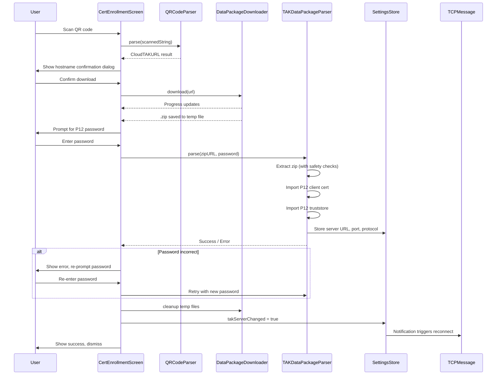
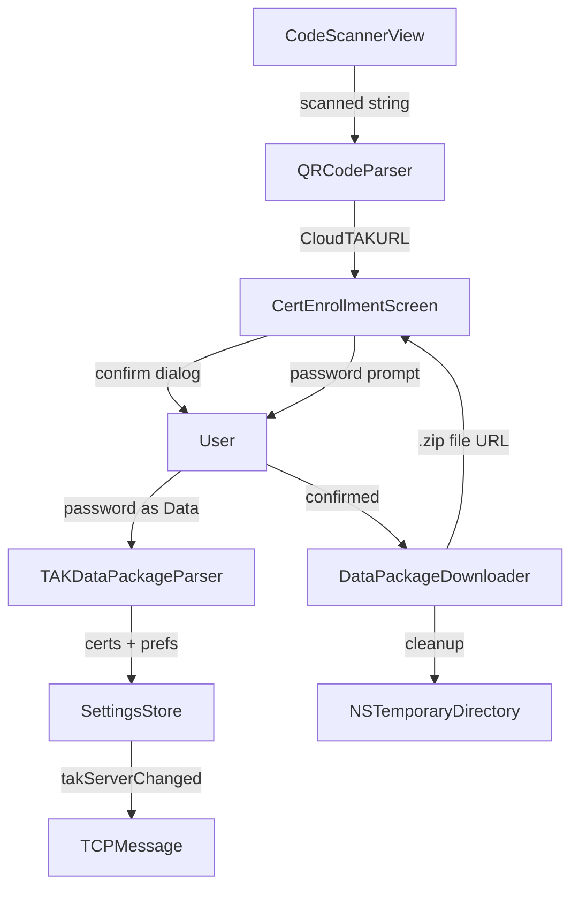

# Design Document: CloudTAK QR Code Import

## Overview

This feature extends TAKAware's QR code scanning flow to recognize CloudTAK-generated HTTPS URLs, download the referenced .zip data package, prompt for a P12 password, import certificates and server preferences, and auto-configure the TAK server connection.

The current `QRCodeParser.parse()` handles two formats: iTAK comma-separated (4 fields) and ATAK JSON (starts with `{`). A third path is added: if the scanned string starts with `https://`, it is treated as a CloudTAK signed URL. The string `http://` is explicitly rejected.

A new `DataPackageDownloader` class handles the HTTPS download with security constraints (HTTPS-only redirects, 50 MB cap, 60s timeout, redirect count cap of 5). The existing `TAKDataPackageParser` is reused for zip extraction and certificate import, with added zip safety checks (path traversal, symlinks, size/entry limits). A P12 password prompt appears after download but before import, allowing retries without re-downloading. On success, `SettingsStore` is configured and reconnection is triggered.

## Architecture

### Sequence Diagram



### Component Diagram



## Components and Interfaces

### 1. QRCodeParser (Modified)

**File:** `TAKAware/Parsers/QRCodeParser.swift`

The `parse()` method gains a third detection branch. The return type changes to accommodate the new CloudTAK URL path.

```swift
// New enum to represent parse results
enum QRCodeParseResult {
    case certificateEnrollment(CertificateEnrollmentParameters)
    case cloudTAKURL(URL)
    case invalid(String) // error message
}

// Updated parse() logic (pseudocode):
func parse() -> QRCodeParseResult {
    guard !originalString.isEmpty else {
        return .invalid("Empty QR code")
    }
    
    // Existing path 1: iTAK comma-separated
    if originalString.split(separator: ",").count == 4 {
        return .certificateEnrollment(parseAsITAKQRCode())
    }
    
    // Existing path 2: ATAK JSON
    if originalString.hasPrefix("{") {
        return .certificateEnrollment(parseAsATAKRegistrationQRCode())
    }
    
    // New path 3: CloudTAK HTTPS URL
    if originalString.lowercased().hasPrefix("https://") {
        guard let url = URL(string: originalString),
              url.host != nil else {
            return .invalid("Malformed URL")
        }
        return .cloudTAKURL(url)
    }
    
    // Reject plaintext HTTP
    if originalString.lowercased().hasPrefix("http://") {
        return .invalid("Only HTTPS URLs are accepted for security reasons")
    }
    
    return .invalid("Unrecognized QR code format")
}
```

**Backward compatibility:** The existing `CertificateEnrollmentParameters` struct and its `wasInvalidString` field remain. The static `QRCodeParser.parse(_:) -> CertificateEnrollmentParameters` method is preserved for existing callers. A new static method `QRCodeParser.parseExtended(_:) -> QRCodeParseResult` is added. The `CertEnrollmentScreen` and `ServerUpdateScreen` callers are updated to use `parseExtended`.

### 2. DataPackageDownloader (New)

**File:** `TAKAware/Communications/DataPackageDownloader.swift`

A new `ObservableObject` class that downloads a .zip from an HTTPS URL with security constraints.

```swift
enum DownloadError: Error, LocalizedError {
    case httpError(statusCode: Int)
    case networkError(Error)
    case invalidFileFormat
    case urlExpired
    case fileTooLarge(Int64)
    case timeout
    case httpRedirectBlocked(String)
    case tooManyRedirects
    
    var errorDescription: String? { /* human-readable messages */ }
}

enum DownloadStatus {
    case idle
    case downloading(progress: Double)
    case completed(URL)
    case failed(DownloadError)
}

class DataPackageDownloader: NSObject, ObservableObject, URLSessionDownloadDelegate, URLSessionTaskDelegate {
    @Published var status: DownloadStatus = .idle
    
    static let maxDownloadSize: Int64 = 50 * 1024 * 1024  // 50 MB
    static let downloadTimeout: TimeInterval = 60
    static let maxRedirects: Int = 5
    
    private var redirectCount = 0
    private var tempFileURL: URL?
    
    /// Downloads the .zip to NSTemporaryDirectory() with mode 0600
    func download(from url: URL) async throws -> URL
    
    /// Cleans up temp .zip and any extracted contents
    func cleanup()
    
    /// Called on app launch to sweep orphaned temp files
    static func sweepOrphanedTempFiles()
    
    // MARK: - URLSessionTaskDelegate
    // Redirect inspection: reject non-HTTPS, enforce redirect cap of 5
    func urlSession(_ session: URLSession,
                    task: URLSessionTask,
                    willPerformHTTPRedirection response: HTTPURLResponse,
                    newRequest request: URLRequest,
                    completionHandler: @escaping (URLRequest?) -> Void)
    
    // MARK: - URLSessionDownloadDelegate
    // Progress tracking + size enforcement
    func urlSession(_ session: URLSession,
                    downloadTask: URLSessionDownloadTask,
                    didWriteData bytesWritten: Int64,
                    totalBytesWritten: Int64,
                    totalBytesExpectedToWrite: Int64)
    
    func urlSession(_ session: URLSession,
                    downloadTask: URLSessionDownloadTask,
                    didFinishDownloadingTo location: URL)
}
```

**Key behaviors:**
- Creates a `URLSession` with `timeoutIntervalForRequest = 60`
- Redirect delegate checks `newRequest.url?.scheme == "https"`, increments redirect counter, aborts if > 5
- On download completion, moves file to `NSTemporaryDirectory()/{UUID}.zip` with `FileManager.setAttributes([.posixPermissions: 0o600])`
- Validates HTTP status code (403 → "URL expired" hint)
- Checks `Content-Length` or accumulated bytes against 50 MB cap

### 3. TAKDataPackageParser (Modified)

**File:** `TAKAware/Parsers/TAKDataPackageParser.swift`

The existing parser is extended with:

1. **Password parameter:** A new `parse(password:)` method that accepts the P12 password as `Data` (not `String`) and passes it through to `PKCS12` and `NIOSSLPKCS12Bundle`.

2. **Zip extraction safety** (applied in the underlying `DataPackageParser` or a new wrapper):
   - Path traversal check: resolve each entry's canonical path and verify it starts with the extraction directory
   - Reject entries with absolute paths
   - Reject symbolic link entries
   - Track cumulative uncompressed size, abort at 250 MB
   - Track entry count, abort at 1000

```swift
// New method signature
func parse(p12Password: Data) {
    let parser = DataPackageParser(fileLocation: archiveLocation)
    parser.parse() // with safety checks
    let contents = parser.packageContents
    storeUserCertificate(packageContents: contents, password: p12Password)
    storeServerCertificate(packageContents: contents, password: p12Password)
    storePreferences(packageContents: contents)
}
```

### 4. P12 Password Handling

**Security flow:**

1. Password collected via `SecureField` with `.autocorrectionDisabled(true)` and `.textContentType(.password)`
2. Immediately converted to `Data` using UTF-8 encoding
3. The `String` binding is cleared after conversion
4. `Data` buffer passed to `SecPKCS12Import` / `NIOSSLPKCS12Bundle`
5. After import (success or failure), the `Data` buffer is zeroed using `withUnsafeMutableBytes { memset_s($0.baseAddress!, $0.count, 0, $0.count) }` — this uses the compiler-safe `memset_s` equivalent that cannot be optimized away
6. Password is never stored in `@Published` properties, `UserDefaults`, Keychain, or logs

```swift
// Compiler-safe zeroing
func zeroPasswordBuffer(_ buffer: inout Data) {
    buffer.withUnsafeMutableBytes { ptr in
        if let baseAddress = ptr.baseAddress {
            // memset_s is guaranteed not to be optimized away
            _ = memset_s(baseAddress, ptr.count, 0, ptr.count)
        }
    }
    buffer = Data()
}
```

### 5. CertEnrollmentScreen (Modified)

**File:** `TAKAware/Screens/SettingsScreens/ConnectionOptions.swift`

The `processQRCode` method is updated to handle `QRCodeParseResult.cloudTAKURL`:

**New state variables:**
```swift
@State var isShowingHostConfirmation = false
@State var cloudTAKURL: URL? = nil
@State var isShowingPasswordPrompt = false
@State var p12PasswordInput = ""
@State var downloadedZipURL: URL? = nil
@StateObject var downloader = DataPackageDownloader()
```

**New UI flow:**
1. QR scan returns `.cloudTAKURL(url)` → set `cloudTAKURL`, show hostname confirmation alert
2. User confirms → `downloader.download(from: url)` → show progress indicator
3. Download completes → show P12 password prompt (SecureField, autocorrection disabled)
4. User enters password → convert to `Data`, clear string, call `TAKDataPackageParser.parse(p12Password:)`
5. If password wrong → show error, re-prompt (zip stays on disk)
6. Success → configure `SettingsStore`, set `takServerChanged = true`, cleanup temp files, show success, dismiss
7. Cancel at any point → cleanup temp files

### 6. Temp File Lifecycle

**Write location:** `NSTemporaryDirectory()/{UUID}.zip`
**Permissions:** `0600` (owner read/write only)
**Cleanup triggers:**
- Import success → `defer { downloader.cleanup() }`
- Import permanent failure → `defer { downloader.cleanup() }`
- User cancels → `defer { downloader.cleanup() }`
- Password retry → file retained (no cleanup until final outcome)

**Startup sweep:** `DataPackageDownloader.sweepOrphanedTempFiles()` called from `AppDelegate` or `@main App.init`. Deletes any `.zip` files in `NSTemporaryDirectory()` matching the UUID naming pattern, catching files left behind by crashes or force-quits.

```swift
static func sweepOrphanedTempFiles() {
    let tempDir = NSTemporaryDirectory()
    let fm = FileManager.default
    guard let files = try? fm.contentsOfDirectory(atPath: tempDir) else { return }
    for file in files where file.hasSuffix(".zip") {
        let path = (tempDir as NSString).appendingPathComponent(file)
        try? fm.removeItem(atPath: path)
        TAKLogger.debug("[DataPackageDownloader] Swept orphaned temp file: \(file)")
    }
}
```

## Data Models

### QRCodeParseResult (New)

```swift
enum QRCodeParseResult {
    case certificateEnrollment(CertificateEnrollmentParameters)
    case cloudTAKURL(URL)
    case invalid(String)
}
```

### DownloadStatus (New)

```swift
enum DownloadStatus {
    case idle
    case downloading(progress: Double)
    case completed(URL)
    case failed(DownloadError)
}
```

### DownloadError (New)

```swift
enum DownloadError: Error, LocalizedError {
    case httpError(statusCode: Int)
    case networkError(Error)
    case invalidFileFormat
    case urlExpired
    case fileTooLarge(Int64)
    case timeout
    case httpRedirectBlocked(String)
    case tooManyRedirects
}
```

### Data Flow Summary

```
QR String
  → QRCodeParser.parseExtended()
  → QRCodeParseResult.cloudTAKURL(URL)
  → Hostname confirmation dialog
  → DataPackageDownloader.download(URL) → temp .zip at NSTemporaryDirectory()
  → P12 password prompt → Data buffer
  → TAKDataPackageParser.parse(p12Password: Data)
    → DataPackageParser extracts zip (safety checks)
    → PKCS12(data:password:) imports client identity
    → NIOSSLPKCS12Bundle imports truststore
    → Preferences → SettingsStore (URL, port, protocol)
  → Zero password buffer
  → SettingsStore.takServerChanged = true
  → TCPMessage.reconnect()
  → Cleanup temp files
```


## Correctness Properties

*A property is a characteristic or behavior that should hold true across all valid executions of a system — essentially, a formal statement about what the system should do. Properties serve as the bridge between human-readable specifications and machine-verifiable correctness guarantees.*

### Property 1: URL scheme determines parse result

*For any* string starting with `https://` that is a well-formed URL with a host, `QRCodeParser.parseExtended()` should return `.cloudTAKURL`. *For any* string starting with `http://`, the parser should return `.invalid` with an error message mentioning HTTPS.

**Validates: Requirements 1.1, 1.2**

### Property 2: Existing QR code formats are preserved

*For any* string with exactly 4 comma-separated values, `QRCodeParser.parseExtended()` should return `.certificateEnrollment` (not `.cloudTAKURL` or `.invalid`). *For any* string starting with `{`, the parser should attempt ATAK JSON parsing and never return `.cloudTAKURL`.

**Validates: Requirements 1.3, 1.4**

### Property 3: URL well-formedness validation

*For any* string starting with `https://` that does not parse as a valid URL with a non-nil host, `QRCodeParser.parseExtended()` should return `.invalid`.

**Validates: Requirements 1.5**

### Property 4: HTTP error status codes appear in error messages

*For any* HTTP error status code (4xx or 5xx), the `DownloadError.httpError(statusCode:)` error description should contain the numeric status code.

**Validates: Requirements 2.5**

### Property 5: Preference extraction round trip

*For any* valid manifest.xml or .pref file containing a server URL, port, and protocol, after `TAKDataPackageParser.storePreferences()` processes the extracted contents, `SettingsStore.takServerUrl`, `SettingsStore.takServerPort`, and `SettingsStore.takServerProtocol` should match the values from the manifest.

**Validates: Requirements 4.1, 4.2, 4.3, 4.4**

### Property 6: Temp file cleanup on terminal states

*For any* download that reaches a terminal state (success, permanent failure, or user cancellation), after `DataPackageDownloader.cleanup()` is called, the temp .zip file and any extracted contents should no longer exist on the filesystem.

**Validates: Requirements 7.1, 7.2, 13.3**

### Property 7: Temp file retained during password retry

*For any* P12 password attempt that fails due to incorrect password, the temp .zip file should still exist on disk after the error is reported, allowing the user to retry without re-downloading.

**Validates: Requirements 8.5, 13.2**

### Property 8: Password non-persistence after import

*For any* P12 password used during import, after the import completes (success or failure), the password should not be present in UserDefaults, Keychain, or any `@Published` property on `SettingsStore`.

**Validates: Requirements 8.6, 12.3**

### Property 9: HTTPS-only download enforcement

*For any* URL passed to `DataPackageDownloader.download()`, if the URL scheme is not `https`, the downloader should reject it with an error before initiating any network request.

**Validates: Requirements 9.4**

### Property 10: Download size limit enforcement

*For any* download where the accumulated bytes exceed 50 MB (52,428,800 bytes), `DataPackageDownloader` should abort the download and report a `fileTooLarge` error.

**Validates: Requirements 9.5**

### Property 11: Path traversal protection

*For any* zip entry whose resolved canonical path does not start with the designated extraction directory, the extraction should skip that entry. This covers entries containing `../`, absolute paths, and any other path manipulation.

**Validates: Requirements 10.1, 10.2, 10.3**

### Property 12: Symlink rejection

*For any* zip entry whose type is a symbolic link, the extraction should reject that entry and log a warning.

**Validates: Requirements 10.4**

### Property 13: Uncompressed size limit

*For any* zip archive whose cumulative uncompressed output exceeds 250 MB, the extraction should abort and report an error.

**Validates: Requirements 10.5**

### Property 14: Entry count limit

*For any* zip archive containing more than 1000 entries, the extraction should abort and report an error.

**Validates: Requirements 10.6**

### Property 15: Redirect scheme enforcement

*For any* HTTP redirect encountered during download, if the redirect destination scheme is `https`, the redirect should be followed. If the destination scheme is anything other than `https`, the download should be aborted with an `httpRedirectBlocked` error. Additionally, if the total redirect count exceeds 5, the download should be aborted with a `tooManyRedirects` error.

**Validates: Requirements 11.2, 11.3**

### Property 16: Password buffer zeroing after import

*For any* `Data` buffer containing a P12 password, after `SecPKCS12Import` completes (success or failure), every byte in the buffer should be zero.

**Validates: Requirements 12.2**

## Error Handling

### Error Categories and User Messages

| Stage | Error | User-Facing Message | Recovery |
|-------|-------|---------------------|----------|
| QR Parse | HTTP URL detected | "Only HTTPS URLs are accepted for security reasons" | Scan different QR code |
| QR Parse | Malformed URL | "The QR code does not contain a valid URL" | Scan different QR code |
| Download | Network error | "Download failed: {error description}" | Retry scan |
| Download | HTTP 403 | "The download URL has expired. Please generate a new QR code in CloudTAK" | Re-generate QR in CloudTAK |
| Download | HTTP 4xx/5xx | "Download failed with status {code}" | Retry scan |
| Download | File too large | "The data package exceeds the 50 MB size limit" | Contact server admin |
| Download | Timeout | "Download timed out after 60 seconds" | Check network, retry |
| Download | HTTP redirect blocked | "Download blocked: redirect to non-HTTPS URL" | Contact server admin |
| Download | Too many redirects | "Download failed: too many redirects" | Contact server admin |
| Extraction | Path traversal | Entry skipped silently, logged as warning | Automatic |
| Extraction | Symlink entry | Entry skipped silently, logged as warning | Automatic |
| Extraction | Size limit exceeded | "Data package extraction aborted: uncompressed size exceeds 250 MB" | Contact server admin |
| Extraction | Entry count exceeded | "Data package extraction aborted: too many files (>1000)" | Contact server admin |
| Import | Invalid zip | "The downloaded file is not a valid data package" | Re-generate QR |
| Import | Missing client cert | "No client certificate found in the data package" | Re-generate QR |
| Import | Wrong P12 password | "Incorrect password. Please try again." | Re-enter password |
| Import | Cert parse failure | "Could not import certificate: {which cert}" | Re-generate QR |
| Import | Missing manifest | "No server connection details found in the data package" | Re-generate QR |
| Import | Incomplete manifest | "Missing connection details: {fields}" | Re-generate QR |

### Error Propagation

Errors are collected as `[String]` in `parsingErrors` (matching existing `TAKDataPackageParser` pattern) and surfaced to the UI via the `CertEnrollmentScreen` alert mechanism. Download errors are propagated via the `DownloadStatus.failed(DownloadError)` published property.

### Logging

All errors are logged via `TAKLogger.error()`. P12 passwords are never included in log output. URL query parameters (which contain CloudFront signatures) are stripped from log messages — only the hostname and path are logged.

## Testing Strategy

### Property-Based Testing

**Library:** [SwiftCheck](https://github.com/typelift/SwiftCheck) (Swift property-based testing library)

**Configuration:** Minimum 100 iterations per property test.

**Tag format:** Each test is tagged with a comment: `// Feature: cloudtak-qr-import, Property {N}: {title}`

Each correctness property above maps to a single property-based test:

1. **Property 1 test:** Generate random well-formed HTTPS URLs and HTTP URLs. Verify parse result type matches scheme.
2. **Property 2 test:** Generate random 4-field comma-separated strings and JSON-prefixed strings. Verify backward-compatible parse paths.
3. **Property 3 test:** Generate random strings starting with `https://` that are not valid URLs (missing host, malformed). Verify `.invalid` result.
4. **Property 4 test:** Generate random HTTP status codes in 400-599 range. Verify error description contains the code.
5. **Property 5 test:** Generate random server URL/port/protocol triples, build a `DataPackageContents`, call `storePreferences`, verify `SettingsStore` values match.
6. **Property 6 test:** Create temp files simulating downloads, call `cleanup()`, verify files are gone.
7. **Property 7 test:** Create temp files, simulate password failure, verify files still exist.
8. **Property 8 test:** After import flow with random passwords, verify no trace in UserDefaults or Keychain.
9. **Property 9 test:** Generate random non-HTTPS URLs, verify downloader rejects them.
10. **Property 10 test:** Generate random byte counts > 50 MB, verify size check triggers abort.
11. **Property 11 test:** Generate random file paths with `../`, absolute paths, etc. Verify canonical path check rejects them.
12. **Property 12 test:** Generate zip entries marked as symlinks. Verify rejection.
13. **Property 13 test:** Generate random cumulative sizes > 250 MB. Verify extraction aborts.
14. **Property 14 test:** Generate random entry counts > 1000. Verify extraction aborts.
15. **Property 15 test:** Generate random redirect URLs with various schemes. Verify HTTPS allowed, others blocked. Test redirect count > 5.
16. **Property 16 test:** Create Data buffers with random passwords, run zeroing function, verify all bytes are 0.

### Unit Tests (Examples and Edge Cases)

Unit tests complement property tests for specific scenarios:

- **Download integration:** Mock URLSession to test successful download, 403 response, network timeout
- **Zip validation:** Test with a real minimal .zip containing P12 + manifest, verify end-to-end import
- **Password retry:** Test that after wrong password, re-entering correct password succeeds without re-download
- **Startup sweep:** Create orphaned .zip files in temp dir, call `sweepOrphanedTempFiles()`, verify deletion
- **Temp file permissions:** After download, verify file attributes show `0600`
- **Redirect cap:** Mock 6 sequential HTTPS redirects, verify `tooManyRedirects` error
- **Empty QR code:** Verify `.invalid` result
- **Mixed format detection:** Test strings that could be ambiguous (e.g., `https://` with 4 commas)
